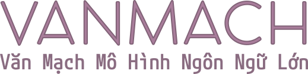
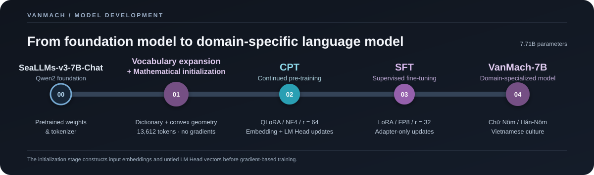
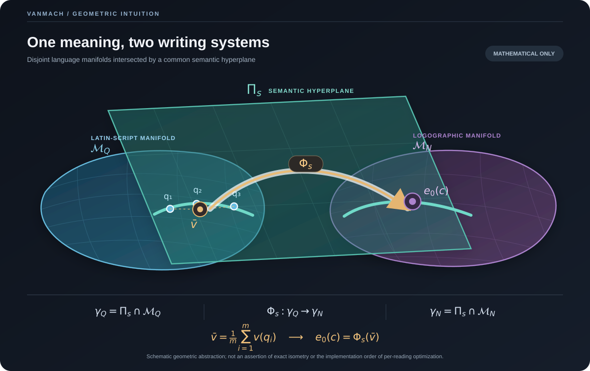

<p align="center">
  <br>
  
</p>

# _VanMach-7B_ : Van Mach Large Language Model

### Documentation Languages

[**English**](./README.md) | [**Chinese Simplified**](./README.zh-CN.md) | [**Chinese Traditional**](./README.zh-TW.md) | [**Vietnamese**](./README.vi.md)

### Open-source Repository

[**https://huggingface.co/Duyu/VanMach-7B**](https://huggingface.co/Duyu/VanMach-7B)

## 1. Model Overview

**Van Mach (Vietnamese: Văn Mạch; Chinese: 文脉大模型; Model ID: VanMach-7B)** is a 7B-scale multilingual large language model designed for Vietnamese traditional writing (Chữ Nôm), historical documents, and linguistic and cultural studies. Built upon [SeaLLMs-v3-7B-Chat](https://huggingface.co/SeaLLMs/SeaLLMs-v3-7B-Chat), the model enhances its capabilities in processing Vietnamese Chữ Nôm, modern Vietnamese, historical Hán-Nôm documents, and traditional Vietnamese cultural knowledge through a specially designed Chữ Nôm vocabulary expansion, purely mathematical embedding initialization, continued pre-training (CPT), and supervised fine-tuning (SFT). Unlike general-purpose models primarily developed for modern Vietnamese natural language processing tasks, our VanMach-7B places **the computational linguistic representation of Chữ Nôm, historical linguistic knowledge, and their connections to modern Vietnamese** at the center of its development. The model supports three languages and their corresponding writing systems: **Vietnamese** 【Chữ Quốc ngữ and the historically used Chữ Nôm】, **Chinese** 【Simplified Chinese and Traditional Chinese】, and **English**.

Chữ Nôm is an important writing system historically used to represent the Vietnamese language. Although its character forms are closely related to the Chinese character system, it has distinctive characteristics in meaning, pronunciation, graphical composition, and actual usage. Many Chữ Nôm characters occur extremely infrequently in the training corpora of modern general-purpose large language models, and some cannot even obtain independent, complete Token representations through existing tokenizers. Meanwhile, the amount of digitized training data available for Chữ Nôm remains relatively limited, particularly the lack of large-scale, systematically curated, high-quality data aligned with modern Vietnamese. These circumstances present several significant challenges for conventional large language model fine-tuning methods:

1. **Insufficient Character Representation**: Many Chữ Nôm characters lack independent Tokens and are easily split into multiple subword or byte-level Tokens, making it difficult to establish stable semantic representations for individual characters.
2. **Scarcity of Training Data**: Hán-Nôm documents and Chữ Nôm dictionaries possess substantial linguistic and historical value, but the amount of data directly usable for large language model training is relatively limited.
3. **Slow Convergence with Random Initialization**: If newly added Chữ Nôm embeddings are initialized randomly, the model must simultaneously learn fundamental character representations, pronunciation associations, and contextual semantics from limited training data.
4. **Difficulties in Cross-Script Alignment**: Chữ Nôm, Chinese characters, and modern Vietnamese Chữ Quốc ngữ have complex historical and linguistic relationships that are difficult to establish adequately through ordinary text training alone.
5. **Limited Computational Resources**: Large-scale vocabulary expansion and continued training generally require additional GPU memory and computational overhead, posing particular challenges in single-GPU environments.

To address these challenges, VanMach-7B adopts a technical approach that differs from simple random initialization followed by direct fine-tuning:

**First, dictionary knowledge, existing Chinese character vectors, Vietnamese pronunciation representations, and convex optimization methods are used to construct linguistically informed initial representations for newly added Chữ Nôm characters (injecting character-level embeddings) before training begins. Subsequently, CPT and SFT progressively enable the model to learn actual Chữ Nôm usage, correspondences with modern Vietnamese, and related cultural knowledge.**

## 2. Basic Model Information

### 2.1 Model Specifications

| Item | Specification |
|---|---|
| Model Name | Van Mach (Vietnamese: Văn Mạch; Chinese: 文脉大模型) |
| Model ID | VanMach-7B |
| Model Type | Autoregressive causal language model |
| Model Architecture | Qwen2ForCausalLM |
| Base Model | SeaLLMs-v3-7B-Chat |
| Model Size | **7.71B** (7,713,187,328) |
| Model Weight Data Size | Approximately **14.37 GiB** (15,426,374,656 bytes) |
| Vocabulary Size | 165,676 (original size: 152,064) |
| Number of Added Chữ Nôm Tokens | **13,612** |
| Embedding Dimension | 3,584 |
| Additional Embedding and Output Layer Parameters | Untied, approximately 97.57M (97,570,816) |
| Supported Languages | Vietnamese, Chinese, English |
| Specialized Domains | Chữ Nôm, Hán-Nôm documents, modern Vietnamese, Vietnamese history and culture |

### 2.2 Model Origins and Technical Lineage

VanMach-7B is developed directly from SeaLLMs-v3-7B-Chat.

<p align="center">
  <br>
  
</p>

SeaLLMs-v3-7B-Chat is a multilingual conversational model designed for Southeast Asian languages. According to the official SeaLLMs 3 technical paper, its foundation model originates from the **Qwen2 family**.

## 3. Training Corpora and Knowledge Sources

The training corpora of VanMach-7B primarily cover traditional Vietnamese writing, historical literature, Hán-Nôm dictionaries, optical character recognition data, and modern Vietnamese lexical knowledge. Unlike general-purpose language models trained primarily on large-scale web text, this project makes extensive use of dictionaries and textual resources with explicit linguistic structures, applying them to embedding initialization, continued pre-training, and supervised fine-tuning.

#### Tự Điển Chữ Nôm Dẫn Giải

*Tự Điển Chữ Nôm Dẫn Giải* (Chinese: 《喃字释义辞典》; Explanatory Dictionary of Chữ Nôm) is one of the project's important sources of Chữ Nôm linguistic knowledge. Such resources contain Chữ Nôm characters together with their pronunciations, definitions, and orthographic information, providing valuable foundations for establishing connections between Chữ Nôm and modern Vietnamese. During model development, dictionary-based data are primarily used to establish correspondences between Chữ Nôm characters and their Chữ Quốc ngữ pronunciations, provide the linguistic knowledge required for mathematical initialization of newly added Chữ Nôm Tokens, and construct structured training texts.

#### Chữ Nôm Standardization Table of the Vietnamese Hán-Nôm Revival Committee

The project also uses the Chữ Nôm standardization table published by **Ủy ban Phục sinh Hán Nôm Việt Nam (Chinese: 越南汉喃复兴委员会)**. These resources supplement and organize information about Chữ Nôm characters, providing references for character coverage, vocabulary expansion, and character normalization.

#### Hugging Face Hán-Nôm and Sino-Vietnamese Pronunciation Datasets

In addition, the training process incorporates several Hán-Nôm and Sino-Vietnamese pronunciation datasets available on Hugging Face. These datasets supplement the orthographic and phonetic relationships among Chữ Nôm, Chinese characters, Sino-Vietnamese pronunciations, and the Vietnamese language.

#### Classical Vietnamese Literature

To expose the model to linguistic forms within authentic historical contexts, VanMach-7B incorporates multiple works of classical Vietnamese literature.

The main works include:

| Corpus | Content and Training Value |
|---|---|
| *Truyện Kiều* (Chinese: 《金云翘传》) | A representative work of classical Vietnamese literature, used to construct parallel Chữ Quốc ngữ–Chữ Nôm corpora and supplement historical Vietnamese expressions and literary vocabulary |
| *Chinh phụ ngâm* (Chinese: 《征妇吟》) | Used to learn classical literary language, poetic expressions, and related cultural knowledge |
| *Lục Vân Tiên* (Chinese: 《蓼云仙》) | Used to supplement traditional Vietnamese narrative literature and historical linguistic materials |
| *Poetry of Hồ Xuân Hương* (Chinese: 《胡春香诗集》) | Used to supplement classical Vietnamese poetry, literary language, cultural imagery, and traditional expressions |
| *Đại Việt sử ký* (Chinese: 《大越史记》) | Used to supplement knowledge of Vietnamese history, traditional institutions, historical figures, geographical names, historical events, and related Literary Chinese and Hán-Nôm writing forms. |

#### OCR Text Data

The project uses text data released by **NomNaOCR**.

## 4. Model Training

The training of VanMach-7B consists of three stages. First, Chữ Nôm dictionaries, the original model's embedding space, and convex optimization methods are used to initialize the input embeddings and LM Head weights for 13,612 newly added Chữ Nôm Tokens. Next, continued pre-training (CPT) combines Hán-Nôm documents, modern Vietnamese, and structured dictionary corpora to further train the representations of newly added Chữ Nôm characters and related Chinese characters while incorporating domain-specific linguistic and cultural knowledge. Finally, supervised fine-tuning (SFT) uses parallel corpora and structured question-answering data to strengthen the model's understanding of Chữ Nôm, Hán-Nôm documents, and Vietnamese linguistic and cultural knowledge, as well as its ability to follow instructions.

### 4.1 Initialization Method for Newly Added Chữ Nôm Embeddings

Because the original model lacks independent Token representations for many Chữ Nôm characters, while the available Hán-Nôm training corpora and computational resources are relatively limited, direct random initialization cannot adequately exploit existing linguistic knowledge. This project therefore designs an embedding initialization algorithm based on dictionary mappings, character-form conversion, and convex optimization. Before gradient-based training begins, the algorithm constructs linguistically informed initial representations for newly added Chữ Nôm characters. Let the original model's vocabulary size be $V_0=152064$ and its embedding dimension be $d=3584$. Denote the input embedding matrix and the language model output weight matrix by $E,W\in\mathbb{R}^{V_0\times d}$, respectively. For any Token ID $t$ in the original tokenizer, let $E_t$ and $W_t$ denote the corresponding row vectors in these two matrices. The algorithm constructs initial vectors for new characters separately in the input and output parameter spaces.

**Character Recognition and Direct Mapping.** First, the algorithm reads a Chữ Nôm–Chữ Quốc ngữ pronunciation dictionary, applies Unicode NFC normalization to characters and pronunciations, normalizes case and whitespace, and merges duplicate pronunciations. It then uses the original tokenizer to identify known characters: a character is considered to have a valid independent representation only if it can be encoded as exactly one non-special Token and the decoded result matches the original character exactly. For Chữ Nôm characters that cannot yet be independently encoded, the algorithm first attempts character-form conversion using OpenCC's `t2s` rules. If the converted result is a different single character that already has an independent Token, the corresponding weights are copied separately from the input embedding matrix and the LM Head. All remaining characters proceed to the pronunciation-based mathematical initialization process.

<p align="center">
  <br>
  
</p>

**Pronunciation Representations and Reference Anchors.** To exploit the correspondences between existing characters and modern Vietnamese pronunciations, the algorithm first constructs a pronunciation reference set from the dictionary. Specifically, known characters sharing the same Chữ Quốc ngữ pronunciation are grouped together, and a set of reference vectors is established for each valid pronunciation and its corresponding known-character set. Let $q$ denote a particular Chữ Quốc ngữ pronunciation, and let $T(q)=(t_1,\ldots,t_m)$ be the sequence of Token IDs obtained by encoding that pronunciation with the original tokenizer, where $m=|T(q)|$ is the sequence length. Let $H(q)$ denote the set of Token IDs corresponding to known dictionary characters that share this pronunciation and can be independently encoded by the original tokenizer. For pronunciations with valid $T(q)$ and nonempty $H(q)$, define:

$$
v_q=\frac{1}{|T(q)|}\sum_{t\in T(q)}E_t,\qquad
C_q=\frac{1}{|H(q)|}\sum_{h\in H(q)}E_h,\qquad
U_q=\frac{1}{|H(q)|}\sum_{h\in H(q)}W_h
$$

Here, $v_q$ represents the position of the Chữ Quốc ngữ pronunciation in the original embedding space, while $C_q$ and $U_q$ represent the input embedding centroid and LM Head weight centroid, respectively, of known characters sharing that pronunciation. Thus, each valid pronunciation corresponds to a triplet $(v_q,C_q,U_q)$, referred to as a **pronunciation anchor**. Indexed by Chữ Quốc ngữ pronunciation, a pronunciation anchor connects the vector representation of a pronunciation with the input and output parameters of existing characters through the character–pronunciation correspondences recorded in the dictionary. Pronunciation vectors are obtained by averaging the embeddings of the original tokenization results, without training an additional encoder. No valid pronunciation anchor is constructed for pronunciations that cannot be encoded properly or whose encodings contain unknown or special Tokens. Reference characters are strictly limited to dictionary characters that can already be independently encoded by the original tokenizer; the algorithm does not directly use the entire Unicode CJK character range or all Chinese characters in the original vocabulary as anchors.

**Convex Optimization and Vector Transfer.** For a target pronunciation that has no directly available same-pronunciation character reference centroid but can be represented by the original tokenizer, the algorithm reformulates its representation problem as the projection of its pronunciation vector onto the convex hull of existing pronunciation anchors. Suppose the pronunciation reference set contains $n$ valid anchors, corresponding to Chữ Quốc ngữ pronunciations $q_1,q_2,\ldots,q_n$, and denote their three associated vectors by $v_i=v_{q_i}$, $C_i=C_{q_i}$, and $U_i=U_{q_i}$, respectively. For a target pronunciation $q$ not included in this reference set, the algorithm first computes its pronunciation vector $v_q$ as described above. It then searches for a set of combination coefficients $\boldsymbol{\alpha}=(\alpha_1,\ldots,\alpha_n)$ that minimizes the Euclidean distance between the weighted sum of reference pronunciation vectors and the target pronunciation vector:

$$
\boldsymbol{\alpha}^{*}
=\arg\min_{\boldsymbol{\alpha}}
\frac{1}{2}\left\|
\sum_{i=1}^{n}\alpha_i v_i-v_q
\right\|_2^2,
\qquad
\alpha_i\geq0,\quad
\sum_{i=1}^{n}\alpha_i=1
$$

Here, $\alpha_i$ denotes the combination weight of the $i$-th pronunciation anchor, $\boldsymbol{\alpha}^{*}$ denotes the optimal coefficient vector satisfying the constraints, and $\|\cdot\|_2$ denotes the Euclidean norm. This is a convex quadratic optimization problem with probability simplex constraints. Its objective is to find the position within the convex hull formed by existing pronunciation reference vectors that is closest to the target pronunciation. After solving the problem, the algorithm does not directly use the convex projection vector as the character embedding. Instead, it applies the resulting combination coefficients separately to the input and output reference centroids of the corresponding pronunciation anchors:

```math
\widehat{E}_q=\sum_{i=1}^{n}\alpha_i^{*}C_i \qquad \widehat{W}_q=\sum_{i=1}^{n}\alpha_i^{*}U_i
```

Here, $\widehat E_q$ and $\widehat W_q$ denote the input embedding reference vector and LM Head weight reference vector constructed for the target pronunciation $q$, respectively. Thus, the Chữ Quốc ngữ pronunciation vectors determine the combination relationships among different reference anchors, while the input embeddings and LM Head weights of existing characters are used to construct the actual initialization parameters. This allows the algorithm to exploit the original model's existing Vietnamese pronunciation representations and Chinese character and Chữ Nôm parameter information, rather than placing all newly added characters at random positions.

**Numerical Solution and Convergence Control.** The implementation employs Frank–Wolfe-type conditional gradient iterations, selecting reference vertices according to the current projection residual and updating the convex combination through an analytical line search constrained to the interval $[0,1]$. Rather than constructing a complete large-scale anchor Gram matrix, the algorithm uses GPU-based FP64 vector inner products and matrix operations, with periodic local refinement of the active reference set using SLSQP. Reference vectors are scale-normalized according to the median of their norms. The default maximum number of iterations is 1,800, and the optimality tolerance is $2\times10^{-8}$. The Frank–Wolfe gap is also used to assess the numerical convergence of the primary optimization.

Because different convex combinations may produce the same projection vector, the algorithm further attempts minimum-norm optimization after the primary optimization satisfies its convergence conditions. Let the projection position obtained from the primary optimization be $p^{*}=\sum_{i=1}^{n}\alpha_i^{*}v_i$. Keeping this projection position unchanged, the algorithm further solves:

$$
\min_{\boldsymbol{\alpha}}
\frac{1}{2}\|\boldsymbol{\alpha}\|_2^2,
\qquad
\sum_{i=1}^{n}\alpha_i v_i=p^{*},\quad
\sum_{i=1}^{n}\alpha_i=1,\quad
\alpha_i\geq0
$$

This secondary optimization aims to select a solution with a smaller Euclidean norm from the feasible coefficient combinations corresponding to the same projection position. If the solution passes numerical validation, the refined coefficients are used to construct the aforementioned input and output reference vectors. The secondary optimization combines singular value decomposition (SVD), SLSQP, L-BFGS-B dual optimization, and Karush–Kuhn–Tucker (KKT) optimality condition checks to seek a stable coefficient solution while preserving the projection position and convex combination constraints. If full convergence is not achieved or numerical validation fails, the program retains the best feasible combination found so far and records its corresponding status, avoiding the loss of a character's initialization result solely because of a local numerical solver failure.

**Multiple-Pronunciation Handling and Fallback Mechanism.** For Chữ Nôm characters with multiple Chữ Quốc ngữ pronunciations, the algorithm constructs input and output reference vectors separately for each pronunciation and then takes the arithmetic mean of the resulting vectors to obtain the character's initial parameters. Specifically, let $c$ be a Chữ Nôm character to be initialized, and let $R(c)$ be the set of distinct Chữ Quốc ngữ pronunciations recorded for that character in the dictionary. Let $e_c^{(0)}$ and $w_c^{(0)}$ denote the final initial input embedding and LM Head vectors of that character, respectively. For characters initialized through pronunciation-based methods, we have:

$$
e_c^{(0)}=\frac{1}{|R(c)|}\sum_{q\in R(c)}\widehat E_q,
\qquad
w_c^{(0)}=\frac{1}{|R(c)|}\sum_{q\in R(c)}\widehat W_q
$$

For pronunciations that directly match an entry in the pronunciation reference set, $\widehat E_q$ and $\widehat W_q$ are taken directly from the corresponding $C_q$ and $U_q$. For pronunciations that do not match directly but can be encoded validly, the algorithm uses the results constructed through convex optimization. If an individual pronunciation cannot be encoded validly, lacks usable reference anchors, or cannot form a valid optimization problem, the average input embedding and average LM Head weight of all known dictionary characters are used as fallback vectors for that pronunciation. Valid results from other pronunciations are still retained and included in the final average. Therefore, fallback handling operates at the pronunciation level, rather than discarding all known information about a character because one of its pronunciations is unavailable.

**Distinguishing Duplicate Vectors.** Newly added characters with identical pronunciation combinations or reference relationships ( **variant Chữ Nôm characters** ) may receive identical vectors during initialization. To reduce such occurrences, the program separately examines input embedding and LM Head vector representations at their actual storage precision and applies the smallest effective perturbation when necessary. Specifically, a unit direction is randomly sampled from a Gaussian distribution. Based on adjacent representable values and rounding boundaries in the actual weight formats, such as FP16, BF16, or FP32, the algorithm calculates an approximately minimal step size capable of producing an effective numerical change. Binary search is then used to further reduce the perturbation magnitude. When necessary, a one-ULP (Unit in the Last Place) adjustment to a single coordinate is used as a fallback. This procedure aims to preserve the original initialization vectors as closely as possible, while maintaining valid vector-copying relationships established through direct character-form mapping.

This stage is completed entirely through existing weights, dictionary knowledge, and numerical computation, without any training. Its primary function is to transform existing representational relationships among Chinese characters, Chữ Nôm, and modern Vietnamese into initial parameters for newly added characters. This enables subsequent CPT to begin with linguistically informed vectors and further learn character pronunciations, usage, and semantics through actual contexts.

### 4.2 Continued Pre-Training (CPT)

The CPT stage primarily aims to improve Hán-Nôm character representation learning, Vietnamese language modeling, and domain-specific knowledge incorporation. The training corpora include literary and historical materials such as *Truyện Kiều*, *Chinh phụ ngâm*, *Lục Vân Tiên*, *Đại Việt sử ký*, and the poetry of Hồ Xuân Hương, as well as NomNaOCR text data, Chữ Nôm dictionaries, Chữ Nôm standardization tables, Sino-Vietnamese pronunciation datasets, and modern Vietnamese dictionaries. Continuous texts, including literary works and historical documents, are used directly for autoregressive language model training. Dictionaries, pronunciation tables, and other structured resources are converted into continuous text using predefined templates to establish relationships among Chữ Nôm characters, Chữ Quốc ngữ pronunciations, Sino-Vietnamese readings, definitions, and contexts.

This stage employs the QLoRA algorithm, with the base model weights quantized to NF4 four-bit precision, a LoRA rank of $r=64$, and a text truncation length of 1,024 Tokens. Unlike conventional approaches that train only low-rank adapters, the CPT stage also unfreezes the relevant character embeddings and LM Head, allowing character-level embeddings associated with Simplified Chinese characters, Traditional Chinese characters, and Chữ Nôm to receive explicit gradient updates while also permitting the LM Head to participate in training. This configuration enables further refinement of the newly added Chữ Nôm vectors initialized mathematically in the first stage, as well as adjustment of embeddings for Chinese characters that also function as Chữ Nôm characters.

### 4.3 Supervised Fine-Tuning (SFT)

The SFT stage primarily uses parallel corpora, dictionaries, and other structured data to construct supervised question-answering samples. Its purpose is to strengthen the model's ability to retrieve and apply knowledge of Chữ Nôm pronunciations, definitions, Sino-Vietnamese readings, Chữ Quốc ngữ correspondences, and Vietnamese history and culture, while further training its ability to interpret Hán-Nôm texts and respond to cross-lingual instructions. Training uses the LoRA algorithm with FP8 precision, a rank of $r=32$, and a text truncation length of 1,536 Tokens.

Unlike the CPT stage, the SFT stage freezes the input embedding layer and LM Head, updating parameters only through low-rank adapters. This configuration allows the model to preserve the character representations established during the first two stages while shifting the training focus toward structured knowledge question answering, instruction understanding, and response generation.

|  | Algorithm | Rank | Quantization Precision | Truncation Length |
| --- | --- | --- | --- | --- |
| CPT | QLoRA | 64 | NF4 | 1,024 |
| SFT | LoRA | 32 | FP8 | 1,536 |

### 4.4 Hardware and Software Environment

VanMach-7B was fine-tuned using a single NVIDIA GeForce RTX 5060 Ti 16GB GPU, with Axolotl v0.20.0 as the training framework. CPT and SFT employ QLoRA and LoRA, respectively, to accommodate the computational resource constraints of a single GPU with 16GB of video memory.

## 5. Usage Example

VanMach-7B is based on the Hugging Face Transformers ecosystem and can be loaded using the standard approach for autoregressive language models.

```python
import torch
from transformers import AutoTokenizer, AutoModelForCausalLM

path = "./VanMach-7B"
tokenizer = AutoTokenizer.from_pretrained(path)
model = AutoModelForCausalLM.from_pretrained(
    path, torch_dtype=torch.bfloat16, device_map="cuda"
)
messages = []

while True:
    question = input("User: ")
    messages.append({"role": "user", "content": question})
    inputs = tokenizer.apply_chat_template(
        messages, add_generation_prompt=True, return_tensors="pt"
    ).to(model.device)
    outputs = model.generate(inputs, max_new_tokens=512)
    answer = tokenizer.decode(
        outputs[0][inputs.shape[-1]:], skip_special_tokens=True
    )
    print("Assistant:", answer)
    messages.append({"role": "assistant", "content": answer})
```

## 6. Sources, Licensing, and Usage Statements

### 6.1 Licensing and Redistribution

SeaLLMs-v3-7B-Chat is distributed under the custom SeaLLMs license. As a derivative model, VanMach-7B must comply with the applicable usage and redistribution conditions of its upstream model. These terms address original rights notices, redistribution of derivative models, modification notices, attribution, usage restrictions, and other conditions. When publishing or using this model, the applicable upstream licensing requirements must also be retained and observed.

The technical descriptions in this model card do not constitute any modification of or exemption from the licensing restrictions of the base model.

### 6.2 Training Data Statements

The materials used by VanMach-7B include traditional literature, historical texts, dictionaries, OCR data, and related linguistic datasets from public platforms. Different data sources may be subject to different copyright, usage, and redistribution conditions. Public release of the model does not imply that all training materials may be redistributed without restriction. The use and redistribution of training corpora must comply with their respective applicable licenses and legal requirements.

### 6.3 Disclaimer

VanMach-7B is primarily intended for natural language processing, Hán-Nôm studies, and related linguistic and cultural applications. Because the model relies on statistical learning methods, its outputs may contain factual errors, pronunciation confusion, incorrect definitions, or other inaccuracies. In educational settings, historical document research, professional translation, and other contexts requiring high accuracy, model outputs should be used in conjunction with reliable reference materials and human review.

## 7. Author

[**DU Yu**](https://faculty.lzjtu.edu.cn/chenmei/zh_CN/xsxx/2554/content/1837.htm) (Vietnamese: ĐỖ Vũ; Chinese: 杜宇, No.11250717, Email: <qluduyu09@163.com> or <qluduyu09@gmail.com> or <11250717@stu.lzjtu.edu.cn> ), **School of Electronic and Information Engineering, Lanzhou Jiaotong University (Chinese: 兰州交通大学电子与信息工程学院)**
